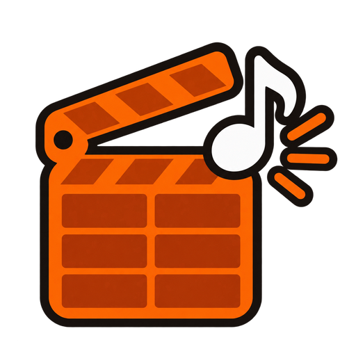
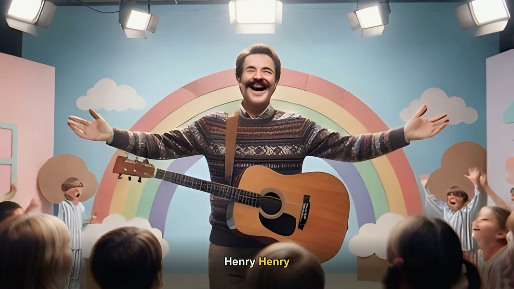
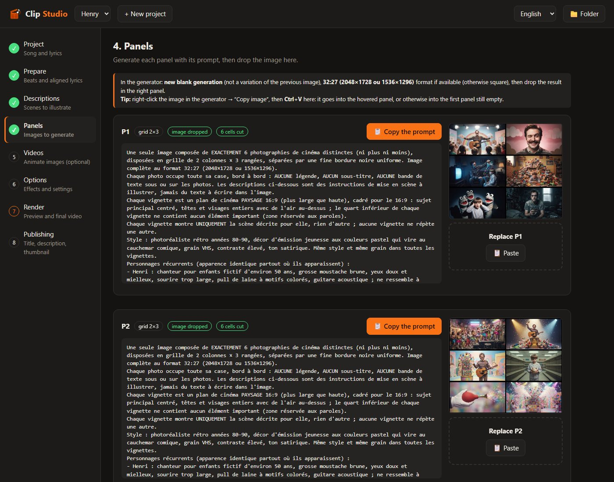
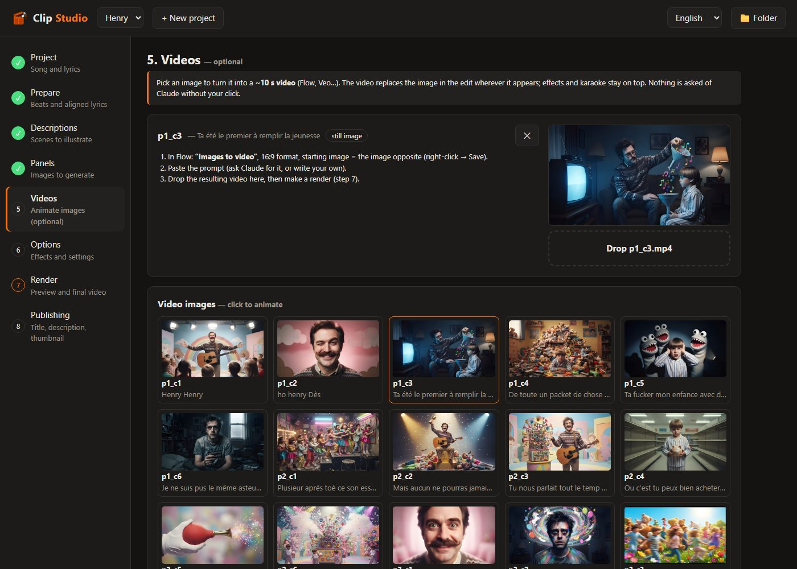
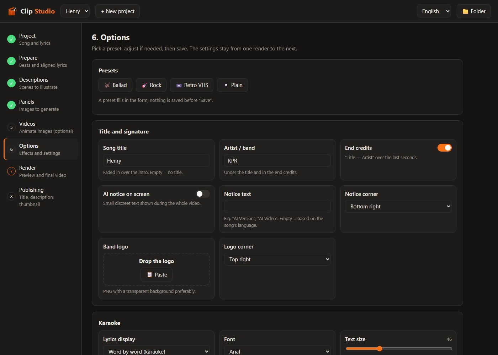

<p align="center"></p>

# Clip Studio

[Français](README.md) | **English**

[](https://github.com/BandDiLondon/Clip-Studio/actions/workflows/tests.yml)
[](../../releases/latest)
[](LICENSE)

Clip Studio makes illustrated music videos from a song (mp3) and its lyrics (txt). The processing runs locally, on
**Windows**, **Linux** or **macOS** (experimental): lyrics alignment, image cutting, editing and rendering. Only the
tools you choose to use go through the Internet: the image or video generator, and Claude if you click a
"✨ … with Claude" button. Interface and documentation in **English and French**.


<sub>A frame from the video "Henry" (KPR): the scene illustrates the sung line, the current word is highlighted.</sub>

> **Personal project**, shared as is: help is given on a best-effort basis, with no guaranteed delay. The author is a
> French speaker (Quebec): French is the original language of Clip Studio, the English texts are translations. To
> report a problem, open an [issue](../../issues) with your system, the Clip Studio version and the error message.
> Issues are welcome in English or French; corrections to the English are welcome too.

- Each unique lyric line gets its own image. Images are generated as **panels** (6 cells per generated image) to limit
  AI generations.
- The lyrics are shown as **word-by-word karaoke**, thanks to automatic alignment (Whisper / stable-ts), for songs in
  French or English.
- The edit is synced to the detected **beats**.
- Solos become **tracking shots** across panoramic photos.
- **Videos** of ~10 s (Flow, Veo…) can replace any image.
- About a hundred settings are available: camera, looks, particles, smoke, fire, lightning, transitions, 3D parallax,
  16:9 / 4K / 9:16 / 1:1 formats…
- Claude (Claude Code, with a Claude Pro/Max subscription) can write, **only when you click a button**: scene
  descriptions, storyboard evaluation, solo and video prompts, YouTube title and description.
  These calls are designed to **save your usage limit**:
  - "bare" call: without Claude Code's tools, connectors or settings, from an empty folder. About **700 tokens** of
    context per call instead of ~34,500 (measured), for the same answer;
  - a single request for all the images to describe, and only those that don't have a description yet (or those you
    choose to redo);
  - short text-only requests, with JSON answers used directly by Clip Studio.

## Installation

Download the latest version from the **[Releases](../../releases/latest)** tab: one zip per system, with only the
useful files (`…-Windows.zip`, `…-Linux.zip` or `…-macOS.zip`). Then unzip.
(Other options: **Code → Download ZIP**, which contains all systems, or `git clone`.)

### Windows 10 / 11
Double-click **`Installer.bat`**. It installs, if needed, without administrator rights or restart:
- Python 3.12 (python.org);
- the `.venv` environment and the libraries, at the tested versions;
- ffmpeg 8.0.1 (in `tools\ffmpeg`);
- Real-ESRGAN (in `tools\realesrgan`).

Every downloaded file is checked against its SHA256 checksum before being used.

### Linux (Ubuntu 24.04, Debian and derivatives; WSL included)
```
bash installer.sh
```
It installs if needed, with `sudo apt`: `python3-venv`, `ffmpeg`, `curl` and `fonts-liberation`. Then it creates
`.venv` with the libraries and downloads Real-ESRGAN. On another distribution, install these packages yourself before
running it.

### macOS (experimental)
First install [Homebrew](https://brew.sh) (one line to paste in the Terminal). Then, in the Terminal, from the Clip
Studio folder:
```
bash installer.sh
```
It installs if needed, with Homebrew, Python 3.12 and ffmpeg, then creates `.venv` and downloads Real-ESRGAN (Intel
Macs and Apple chips).

**Experimental**: the installation and a complete video are tested automatically on GitHub's Macs at every change, but
nobody has checked the interface on a real Mac yet. Feedback (even "it works") in the [issues](../../issues) is
welcome.

### All systems
- Optional: [Claude Code](https://claude.com/claude-code) for the "✨ … with Claude" buttons.
- The first lyrics alignment downloads the Whisper "medium" model (~1.5 GB, only once). It needs about **5 GB of
  memory**. With less memory, step 2 offers the "small" model (~2 GB, less accurate karaoke).
- The installers and launchers speak the system language (French or English). To force it: `CLIP_LANG=en`.

## Usage

- **Windows**: double-click **`Clip Studio.bat`**. Keep the black window open while you work.
- **Linux**: `./clip-studio.sh`. Keep the terminal open; Ctrl+C stops Clip Studio.
- **macOS**: double-click **`Clip Studio.command`** (the first time, if macOS blocks it: right-click → Open). Keep the
  Terminal window open.

The interface opens in the browser (`http://127.0.0.1:8765`). The language (Français / English) is chosen at the top
right.

Clip Studio guides you step by step, in 8 steps:
1. **Project**: the song, its lyrics and its language.
2. **Prepare**: rhythm and lyrics aligned with the voice.
3. **Descriptions**: one scene per lyric line.
4. **Panels**: the prompts to copy into your image generator, and the panels to drop.
5. **Videos** (optional): animate an image with Flow, Veo…
6. **Options**: presets and effects.
7. **Render**: preview, then final video.
8. **Publishing**: YouTube title, description and thumbnail.

**Panels**: each generated image contains 6 scenes, then Clip Studio cuts and upscales them.



**Videos**: click an image to replace it with a ~10 s video.



**Options**: Ballad / Rock / Retro VHS / Plain presets, and about a hundred settings.



Each project lives in `projets/<name>/`. This folder is not versioned.

- **Command line**: `.venv\Scripts\python.exe -m clip --help` (Windows) or `.venv/bin/python -m clip --help` (Linux,
  macOS). Messages in English with `CLIP_LANG=en`.
- **Backup**: your projects (mp3, images, videos) are not in the repository. **`Sauvegarder les projets.bat`**
  (Windows) or `./sauvegarder-projets.sh` (Linux, macOS) copies them to the folder of your choice.
- **Tests**: `.venv\Scripts\python.exe -m unittest` (Windows) or `.venv/bin/python -m unittest` (Linux, macOS).

## Documentation

- **[User guide](docs/GUIDE.en.md)**: getting started, choosing the image generator, tips, **troubleshooting**.
- **[Technical documentation](docs/TECHNIQUE.en.md)**: architecture, commands, `projet.json` settings, conventions.
- **[Changelog](CHANGELOG.en.md)**.
- **With an AI assistant** (Claude Code, Codex, Cursor…): open the Clip Studio folder with it. It will find its
  instructions in [AGENTS.md](AGENTS.md).

## Requirements and differences between systems

| | Windows | Linux | macOS (experimental) |
|---|---|---|---|
| Memory to align the lyrics | ~5 GB (medium model), ~2 GB (small) | same | same |
| ×4 upscaling of the cells (Real-ESRGAN) | Vulkan graphics card | Vulkan graphics card (Mesa / NVIDIA drivers) | Metal via MoltenVK, included (not yet checked on a real Mac) |
| Without a compatible graphics card | classic upscaling, a bit less sharp | same | same |
| Encoding | AMD GPU (h264_amf) if available, otherwise libx264 | libx264 | libx264 |
| "Open" / "Folder" buttons | File Explorer | `xdg-open` (opens the folder) | Finder |
| Karaoke font | Arial | Liberation Sans (same dimensions) | Arial |

## How Clip Studio was made

Clip Studio is designed and directed by **BandDiLondon**: the idea, the method (including the panels that limit image
generations), the functional choices and the tests on real songs. The code and the documentation were written largely
with **Claude** (Anthropic), an AI assistant, under their direction. Every version is tested before release: automatic
tests on Windows, Linux and macOS, an automatic end-to-end test (installation, then a synthetic song all the way to the
video) on Linux and macOS, and tests on real songs on Windows and Linux.

## License

Copyright (C) 2026 BandDiLondon

Clip Studio is free software. You can redistribute it and modify it under the terms of the
**GNU General Public License version 3** (or any later version), published by the Free Software Foundation.
It is distributed without any warranty. See the [LICENSE](LICENSE) file.

The tools used (ffmpeg, Real-ESRGAN, Whisper / stable-ts, Python libraries) keep their own license.
The projects created with Clip Studio (songs, images, videos) belong to their authors and are not covered by this
license.
