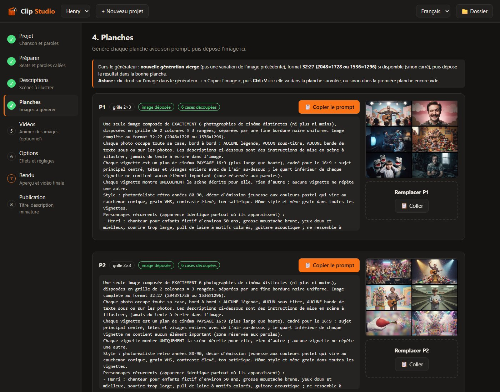
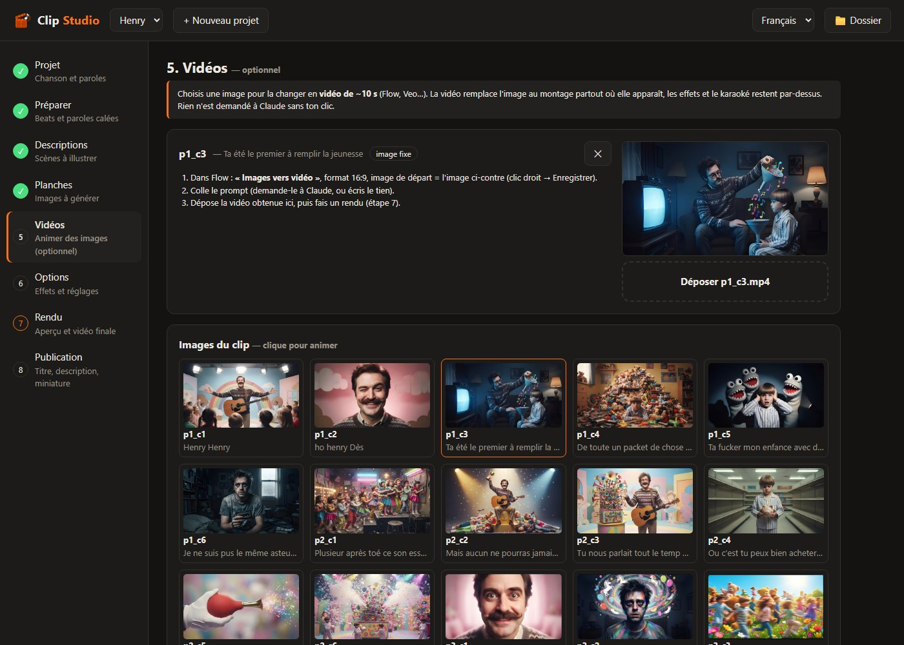
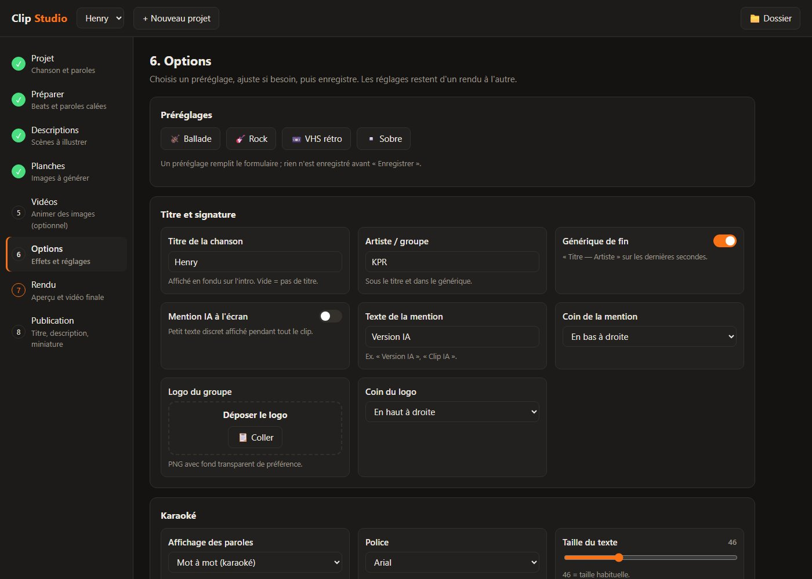

<p align="center"></p>

# Clip Studio

[](https://github.com/BandDiLondon/Clip-Studio/actions/workflows/tests.yml)
[](../../releases/latest)
[](LICENSE)

Clip Studio fabrique des clips musicaux illustrés à partir d'une chanson (mp3) et de ses paroles (txt). Le traitement tourne en
local, sous **Windows** ou **Linux** : alignement des paroles, découpe des images, montage et rendu. Seuls les outils
que tu choisis d'utiliser passent par Internet : le générateur d'images ou de vidéos, et Claude si tu cliques sur un
bouton « ✨ … avec Claude ».


<sub>Une image du clip « Henry » (KPR) : la scène illustre le vers chanté, le mot en cours est surligné.</sub>

> **Projet personnel**, partagé tel quel : l'interface et la documentation sont en français, et l'aide est apportée au
> mieux, sans délai garanti. Pour signaler un problème, ouvre une [issue](../../issues) en indiquant ton système, la
> version de Clip Studio et le message d'erreur.

- Chaque vers unique a son image. Les images sont générées par **planches** (6 cases par image générée) pour limiter les générations IA.
- Les paroles s'affichent en **karaoké mot à mot**, grâce à un alignement automatique (Whisper / stable-ts).
- Le montage est calé sur les **beats** détectés.
- Les solos passent en **travelling** sur des photos panoramiques.
- Des **vidéos** de ~10 s (Flow, Veo…) peuvent remplacer n'importe quelle image.
- Une centaine de réglages sont disponibles : caméra, looks, particules, fumée, feu, éclairs, transitions, parallaxe 3D, formats 16:9 / 4K / 9:16 / 1:1…
- Claude (Claude Code, avec un abonnement Claude Pro/Max) peut rédiger, **uniquement quand tu cliques sur un bouton** : descriptions de scènes, évaluation du storyboard, prompts de solos et de vidéos, titre et description YouTube.
  Ces appels sont conçus pour **ménager ta limite d'utilisation** :
  - appel « nu » : sans outils, connecteurs ni réglages de Claude Code, depuis un dossier vide. Environ **700 tokens**
    de contexte par appel au lieu de ~34 500 (mesuré), pour la même réponse ;
  - une seule demande pour toutes les images à décrire, et seulement celles qui n'ont pas encore de description (ou
    celles que tu choisis de refaire) ;
  - des demandes courtes en texte seul, avec des réponses en JSON directement utilisées par Clip Studio.

## Installation

Télécharger la dernière version dans l'onglet **[Releases](../../releases/latest)** : un zip par système, avec
seulement les fichiers utiles (`…-Windows.zip` ou `…-Linux.zip`). Puis décompresser.
(Autres possibilités : **Code → Download ZIP**, qui contient les deux systèmes, ou `git clone`.)

### Windows 10 / 11
Double-cliquer sur **`Installer.bat`**. Il installe, si besoin, sans droits administrateur ni redémarrage :
- Python 3.12 (python.org) ;
- l'environnement `.venv` et les bibliothèques, aux versions testées ;
- ffmpeg 8.0.1 (dans `tools\ffmpeg`) ;
- Real-ESRGAN (dans `tools\realesrgan`).

Chaque fichier téléchargé est vérifié par son empreinte SHA256 avant d'être utilisé.

### Linux (Ubuntu 24.04, Debian et dérivés ; WSL compris)
```
bash installer.sh
```
Il installe au besoin, avec `sudo apt` : `python3-venv`, `ffmpeg`, `curl` et `fonts-liberation`. Puis il crée `.venv` avec
les bibliothèques et télécharge Real-ESRGAN. Sur une autre distribution, installe ces paquets toi-même avant de le lancer.

### Les deux
- Optionnel : [Claude Code](https://claude.com/claude-code) pour les boutons « ✨ … avec Claude ».
- Le premier alignement des paroles télécharge le modèle Whisper « medium » (~1,5 Go, une seule fois). Il lui faut
  environ **5 Go de mémoire vive**.

## Utilisation

- **Windows** : double-clic sur **`Clip Studio.bat`**. Garde la fenêtre noire ouverte pendant que tu travailles.
- **Linux** : `./clip-studio.sh`. Garde le terminal ouvert ; Ctrl+C arrête Clip Studio.

L'interface s'ouvre dans le navigateur (`http://127.0.0.1:8765`).

Clip Studio guide pas à pas, en 8 étapes :
1. **Projet** : la chanson et ses paroles.
2. **Préparer** : rythme et paroles calées sur la voix.
3. **Descriptions** : une scène par vers.
4. **Planches** : les prompts à copier dans ton générateur d'images, et les planches à déposer.
5. **Vidéos** (optionnel) : animer une image avec Flow, Veo…
6. **Options** : préréglages et effets.
7. **Rendu** : aperçu, puis vidéo finale.
8. **Publication** : titre, description et miniature YouTube.

**Planches** : chaque image générée contient 6 scènes, puis Clip Studio les découpe et les agrandit.



**Vidéos** : clique sur une image pour la remplacer par une vidéo de ~10 s.



**Options** : préréglages Ballade / Rock / VHS rétro / Sobre, et une centaine de réglages.



Chaque projet vit dans `projets/<nom>/`. Ce dossier n'est pas versionné.

- **Ligne de commande** : `.venv\Scripts\python.exe -m clip --help` (Windows) ou `.venv/bin/python -m clip --help` (Linux).
- **Sauvegarde** : tes projets (mp3, images, vidéos) ne sont pas dans le dépôt. **`Sauvegarder les projets.bat`** (Windows)
  ou `./sauvegarder-projets.sh` (Linux) les copie vers le dossier de ton choix.
- **Tests** : `.venv\Scripts\python.exe -m unittest` (Windows) ou `.venv/bin/python -m unittest` (Linux).

## Documentation

- **[Guide d'utilisation](docs/GUIDE.md)** : premiers pas, choix du générateur d'images, conseils, **dépannage**.
- **[Documentation technique](docs/TECHNIQUE.md)** : architecture, commandes, réglages de `projet.json`, conventions.
- **[Journal des versions](CHANGELOG.md)**.
- **Avec un assistant IA** (Claude Code, Codex, Cursor…) : ouvre le dossier de Clip Studio avec lui. Il trouvera ses
  instructions dans [AGENTS.md](AGENTS.md).

## Prérequis et différences Windows / Linux

| | Windows | Linux |
|---|---|---|
| Agrandissement ×4 des cases (Real-ESRGAN) | carte graphique Vulkan | carte graphique Vulkan (pilotes Mesa / NVIDIA) ; sinon, découpe sans agrandissement |
| Encodage | GPU AMD (h264_amf) si disponible, sinon libx264 | libx264 |
| Boutons « Ouvrir » / « Dossier » | Explorateur | `xdg-open` (ouvre le dossier) |
| Police du karaoké | Arial | Liberation Sans (mêmes dimensions) |

## Comment Clip Studio a été fait

Clip Studio est conçu et dirigé par **BandDiLondon** : l'idée, la méthode (dont les planches qui limitent les
générations d'images), les choix fonctionnels et les tests sur de vraies chansons. Le code et la documentation ont été
écrits en grande partie avec **Claude** (Anthropic), un assistant IA, sous sa direction. Chaque version est testée
avant publication (tests automatiques et essais sous Windows et Linux).

## Licence

Copyright (C) 2026 BandDiLondon

Clip Studio est un logiciel libre. Tu peux le redistribuer et le modifier selon les termes de la
**GNU General Public License version 3** (ou toute version ultérieure), publiée par la Free Software Foundation.
Il est distribué sans aucune garantie. Voir le fichier [LICENSE](LICENSE).

Les outils utilisés (ffmpeg, Real-ESRGAN, Whisper / stable-ts, bibliothèques Python) gardent leur propre licence.
Les projets créés avec Clip Studio (chansons, images, vidéos) appartiennent à leurs auteurs et ne sont pas
couverts par cette licence.
